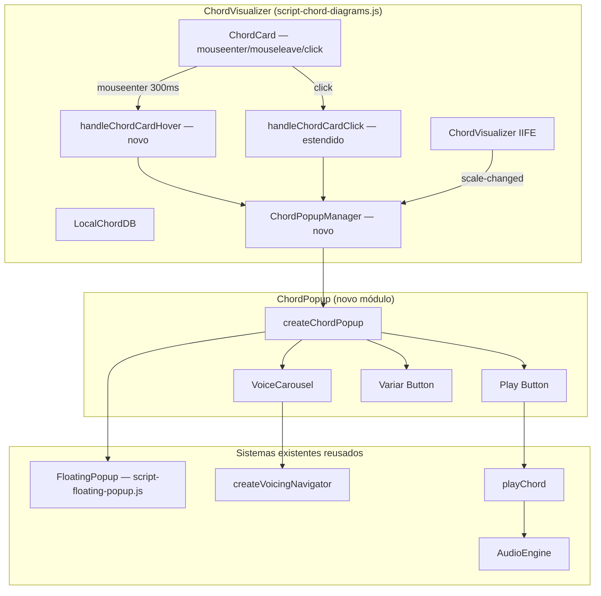

# Design Document: Chord Card Interactive

## Overview

Evolui a interação dos cards de acorde no campo harmônico para um **popup flutuante arrastável**
com hover-preview, seleção de voicing em carrossel e playback. A feature é construída inteiramente
sobre sistemas já existentes: `FloatingPopup` (drag/overlay/focus trap), `createVoicingNavigator`
(índice cíclico), `playChord` (AudioEngine), e `LocalChordDB` (shapes). O ponto de entrada é o
`handleChordCardClick` existente em `script-chord-diagrams.js`, que será estendido.

Nenhuma nova dependência externa é adicionada. Tudo segue o padrão IIFE/Vanilla JS do projeto.

## Architecture



### Decisões Arquiteturais

1. **ChordPopupManager como singleton interno**: Um único módulo interno ao IIFE gerencia o ciclo de
   vida do popup ativo (no máximo um de cada vez). Armazena referência ao popup aberto e ao card
   ativo, expõe `open(card, chord, pinned)`, `pin()`, `close()`.

2. **Hover vs. Pinned como estados distintos**: O popup em hover (transient) não tem controles Play
   e Variar — é só preview. Ao clicar, o mesmo popup é "upgradado" para pinned, injetando os
   controles. Isso evita flicker de recriar o popup no clique.

3. **Reuso de FloatingPopup**: O `FloatingPopup` já implementa drag handle, contenção no viewport,
   focus trap e retorno de foco. O ChordPopup é criado como uma instância de FloatingPopup com
   conteúdo customizado, em vez de reinventar esses mecanismos.

4. **chord-shape-changed como contrato de integração**: Ao selecionar um shape no VoiceCarousel, o
   evento `chord-shape-changed` é despachado. Isso permite que `chord-fretboard-visualization`
   atualize o fretboard e `chord-shape-selector` persista o voicing — sem acoplamento direto.

5. **HoverTimer com grace period**: `mouseenter` agenda abertura após 300ms (evita flicker);
   `mouseleave` agenda fechamento após 150ms (permite mover para o popup sem fechar). Ambos
   cancelados se o mouse entrar no popup.

6. **Sem overlay de fundo**: O popup flutuante não bloqueia o fundo — o usuário pode continuar
   interagindo com a página. Apenas o focus trap se aplica quando o popup é pinned.

## Components and Interfaces

### ChordPopupManager (singleton interno ao IIFE)

```javascript
/**
 * Gerencia o ciclo de vida do ChordPopup ativo (no máximo um por vez).
 */
var ChordPopupManager = {
  _activePopup: null,   // instância FloatingPopup ativa
  _activeCard: null,    // ChordCard DOM element que originou o popup
  _hoverTimer: null,    // timeout de abertura por hover
  _closeTimer: null,    // timeout de fechamento por mouse-out

  /**
   * Abre (ou reabre) o popup para um card.
   * @param {HTMLElement} cardEl - O ChordCard DOM element
   * @param {Object} chord - { name, root, shapes[] }
   * @param {boolean} pinned - Se true, abre já no modo pinned com controles
   */
  open: function(cardEl, chord, pinned) {},

  /**
   * Faz upgrade do popup transient para pinned (adiciona controles).
   */
  pin: function() {},

  /**
   * Fecha e destrói o popup ativo. Remove chord-card-active.
   */
  close: function() {},

  /** Cancela timer de hover pendente. */
  cancelHoverTimer: function() {},

  /** Cancela timer de fechamento pendente. */
  cancelCloseTimer: function() {}
};
```

### createChordPopup (fábrica do popup)

```javascript
/**
 * Cria o elemento DOM do ChordPopup e retorna API de controle.
 *
 * @param {Object} chord - { name, root, shapes[] }
 * @param {number} activeShapeIndex - Índice do shape ativo
 * @param {Object} opts - { pinned: boolean, onClose, onShapeSelect, onPlay, onVarClick }
 * @returns {{ el: HTMLElement, upgrade: Function, destroy: Function }}
 *
 * - el: elemento raiz do popup (para passar ao FloatingPopup)
 * - upgrade(opts): injeta controles Play/Variar num popup transient já aberto
 * - destroy(): remove do DOM e limpa listeners
 */
function createChordPopup(chord, activeShapeIndex, opts) {}
```

### VoiceCarousel (sub-componente do popup)

```javascript
/**
 * Cria o painel de carrossel de shapes.
 *
 * @param {ChordShape[]} shapes - Array de shapes disponíveis
 * @param {number} activeIndex - Índice inicial selecionado
 * @param {Function} onSelect - Callback(index) chamado ao clicar um shape
 * @returns {HTMLElement} O elemento DOM do carrossel
 */
function createVoiceCarousel(shapes, activeIndex, onSelect) {}
```

### Evento chord-shape-changed

```javascript
/**
 * Disparado quando o usuário seleciona um shape no VoiceCarousel.
 *
 * @event chord-shape-changed
 * @type {CustomEvent}
 * @property {Object} detail
 * @property {string} detail.chordName  - Nome do acorde (ex: "Am7")
 * @property {number} detail.shapeIndex - Índice 0-based do shape selecionado
 */
document.dispatchEvent(new CustomEvent('chord-shape-changed', {
  detail: { chordName, shapeIndex }
}));
```

### Modificações em script-chord-diagrams.js

```javascript
// 1. handleChordCardHover — novo, chamado por mouseenter/mouseleave nos cards
function handleChordCardHover(chord, cardEl, entering) {}

// 2. handleChordCardClick — existente, estendido para delegar ao ChordPopupManager
function handleChordCardClick(chord, cardEl) {}

// 3. No render(): adicionar mouseenter/mouseleave em cada .chord-card
cardEl.addEventListener('mouseenter', function() {
  handleChordCardHover(chord, cardEl, true);
});
cardEl.addEventListener('mouseleave', function() {
  handleChordCardHover(chord, cardEl, false);
});
```

## DOM Structure

### ChordPopup — modo transient (hover)

```html
<div class="chord-popup chord-popup--transient" role="tooltip" aria-label="Acorde Am7">
  <div class="chord-popup__handle">⠿ Am7</div>  <!-- drag handle -->
  <div class="chord-popup__diagram">
    <!-- SVG do voicing ativo -->
  </div>
</div>
```

### ChordPopup — modo pinned (clicado)

```html
<div class="chord-popup chord-popup--pinned" role="dialog" aria-label="Acorde Am7" aria-modal="false">
  <div class="chord-popup__header">
    <div class="chord-popup__handle">⠿</div>    <!-- drag handle -->
    <span class="chord-popup__title">Am7</span>
    <button class="chord-popup__close" aria-label="Fechar popup do acorde">×</button>
  </div>
  <div class="chord-popup__diagram">
    <!-- SVG do voicing ativo -->
  </div>
  <div class="chord-popup__actions">
    <button class="chord-popup__play" aria-label="Tocar acorde">▶ Play</button>
    <button class="chord-popup__variar" aria-label="Variar posição do acorde">Variar</button>
  </div>
  <!-- VoiceCarousel — injetado ao clicar Variar -->
  <div class="chord-popup__carousel" hidden>
    <button class="carousel__prev" aria-label="Shape anterior">‹</button>
    <div class="carousel__track">
      <!-- um .carousel__item por shape -->
      <div class="carousel__item carousel__item--active" aria-label="Shape 1 de 3">
        <!-- SVG mini -->
      </div>
      ...
    </div>
    <button class="carousel__next" aria-label="Próximo shape">›</button>
  </div>
</div>
```

## Data Models

### ChordPopupState (interno ao ChordPopupManager)

```javascript
{
  chord: {
    name: string,       // "Am7"
    root: string,       // "A"
    shapes: ChordShape[] // array de shapes do LocalChordDB
  },
  activeShapeIndex: number, // índice do shape sendo exibido
  pinned: boolean,          // true = fixo com controles
  cardEl: HTMLElement,      // ChordCard que originou o popup
  popupEl: HTMLElement      // elemento DOM do popup
}
```

## Correctness Properties

### Property 1: No máximo um popup aberto por vez

*Para qualquer* sequência de hover/click em cards distintos, no máximo um ChordPopup SHALL estar
visível no DOM em qualquer momento.

**Validates: Requirements 1.5, 2.6**

### Property 2: chord-card-active exclusivo

*Para qualquer* sequência de cliques em cards, no máximo um ChordCard SHALL ter a classe
`chord-card-active` ao mesmo tempo. Após fechar o popup, zero cards terão a classe.

**Validates: Requirements 2.7, 2.8**

### Property 3: Posicionamento dentro do viewport

*Para qualquer* posição do ChordCard no viewport, o ChordPopup aberto SHALL ter seus quatro lados
dentro dos limites do viewport (sem overflow).

**Validates: Requirements 6.1, 6.2**

### Property 4: Play usa o shape exibido

*Para qualquer* shape selecionado no VoiceCarousel, o argumento passado a `playChord` SHALL ser
igual ao `ChordShape` no índice `activeShapeIndex` do array `chord.shapes`.

**Validates: Requirements 3.1**

### Property 5: chord-shape-changed reflete seleção no carrossel

*Para qualquer* clique num item do VoiceCarousel, o `detail.shapeIndex` do evento
`chord-shape-changed` SHALL ser igual ao índice 0-based do item clicado.

**Validates: Requirements 4.4**

## Error Handling

| Cenário | Tratamento |
|---------|-----------|
| LocalChordDB sem shapes para o acorde | Não abre popup (req 1.4). Botão Variar desabilitado se shapes.length ≤ 1 (req 4.6). |
| AudioEngine não inicializado | Botão Play desabilitado (greyed out) e inoperante (req 3.3). |
| FloatingPopup não disponível no window | Log de warning; popup renderiza sem drag (degradação graciosa). |
| Clique fora (document click) captura o próprio card | Verificar que `cardEl.contains(e.target)` antes de fechar (evita fechar imediatamente ao abrir). |
| Viewport muito pequeno (mobile) | Popup posiciona acima do card; scroll não reposiciona (popup é fixed). |
| scale-changed chega durante animação de drag | `ChordPopupManager.close()` cancela tudo e remove o elemento imediatamente. |

## Testing Strategy

### Unit Tests (vitest + jsdom)

- `createChordPopup` em modo transient: verifica estrutura DOM mínima (handle, diagram, sem actions).
- `createChordPopup` em modo pinned: verifica presença de Play, Variar, close button e aria attributes.
- `ChordPopupManager.open()`: verifica que um segundo `open()` fecha o primeiro popup.
- `ChordPopupManager.close()`: verifica remoção de `chord-card-active` e destruição do DOM.
- Play button: verifica que `playChord` é chamado com o shape correto.
- Variar button com 1 shape: verifica que botão está desabilitado.
- Escape fecha popup e retorna foco ao card.
- `scale-changed` fecha popup ativo.

### Property-Based Tests (fast-check)

- **Property 1**: Gerar sequência de N cards, executar open/close em ordem aleatória — no máximo 1 popup no DOM.
- **Property 2**: Gerar sequência de cliques — no máximo 1 `chord-card-active` por vez.
- **Property 5**: Para qualquer índice clicado no carrossel, verificar `detail.shapeIndex`.

### Estrutura de Arquivos de Teste

```
tests/cases/chord-card-interactive/
├── chord-popup-lifecycle.unit.spec.js   (open/close/pin, escala, escape)
├── play-button.unit.spec.js             (playChord, AudioEngine indisponível)
├── voice-carousel.unit.spec.js          (seleção, aria, disabled)
├── popup-exclusivity.property.spec.js   (Property 1 e 2)
└── carousel-event.property.spec.js      (Property 5)
```
